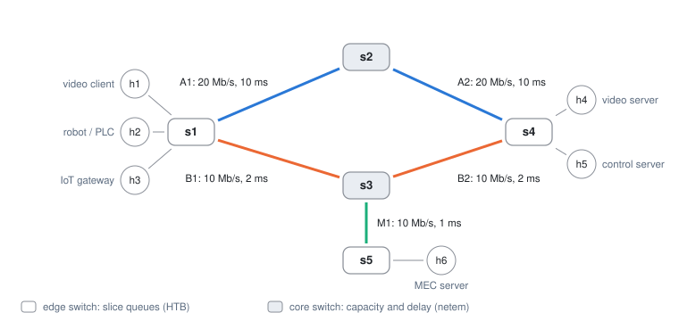
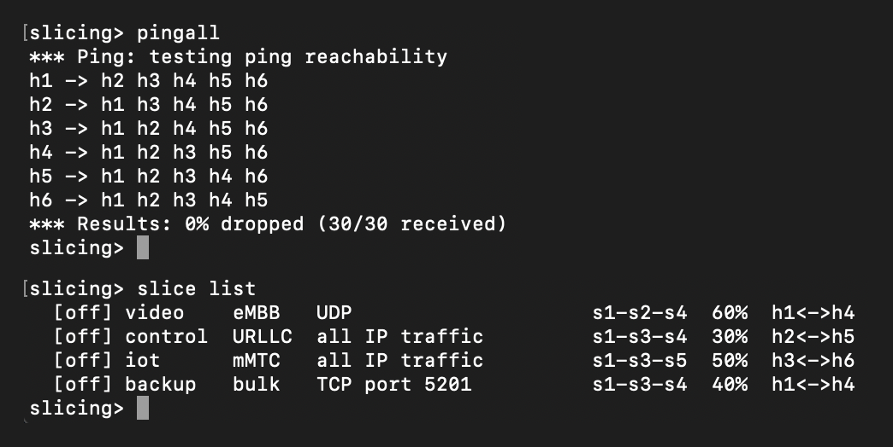
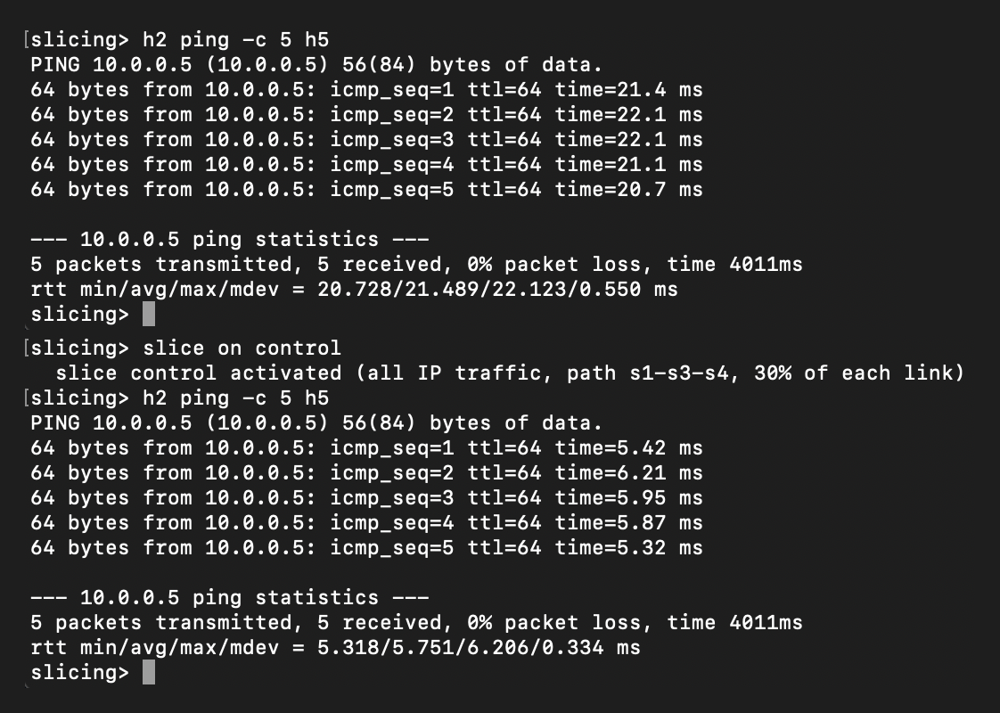
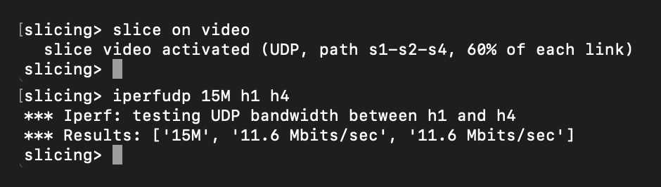
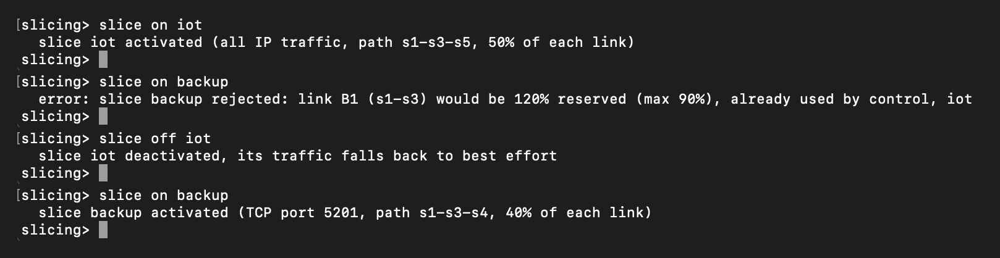
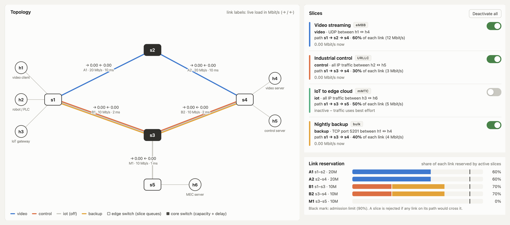
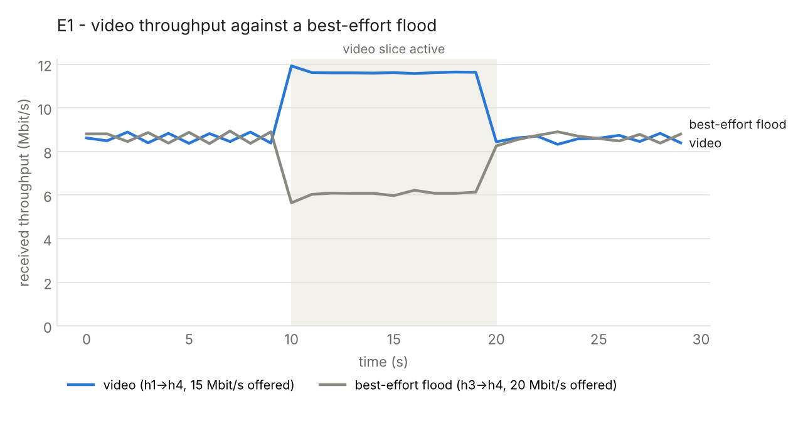
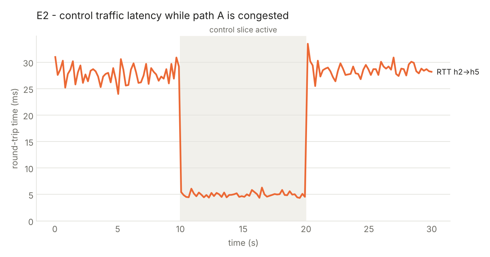
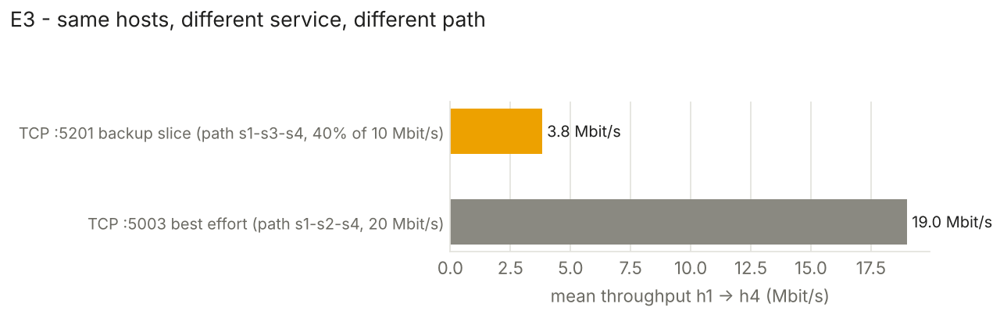

# On-Demand SDN Slicing in ComNetsEmu

Project for Networking (mod. 2), held by Professor Granelli at University of Trento, Student: Alessandro Cazzaniga

Network slices that can be **activated and deactivated at runtime** from a CLI,
a web GUI or a REST API, with a single Ryu SDN controller. Every slice is a
template that states its flows, its topology (the switch path it is
pinned to) and its guaranteed share of link capacity. The controller
enforces the templates with OpenFlow 1.3 rules and Open vSwitch HTB queues, and
refuses activations that would over-book a link (admission control).

<p align="center"></p>

## Contents

1. [Requirements](#1-requirements)
2. [Installation](#2-installation)
3. [Quick start](#3-quick-start)
4. [How it works](#4-how-it-works)
5. [Scenarios step by step](#5-scenarios-step-by-step)
6. [Automated experiments and results](#6-automated-experiments-and-results)
7. [Reference: CLI, GUI, REST API](#7-reference-cli-gui-rest-api)
8. [Project structure and tests](#8-project-structure-and-tests)
9. [Troubleshooting](#9-troubleshooting)
10. [Useful Mininet commands and references](#10-useful-mininet-commands-and-references)

## 1. Requirements

Everything runs inside the **ComNetsEmu** virtual machine used in the course,
which already ships every dependency:

| component | in the VM |
|---|---|
| Ubuntu | 20.04 |
| Python | 3.8 |
| Ryu | 4.34 |
| Mininet, Open vSwitch, iperf (v2) | included |

Optional: `matplotlib`, only to draw the experiment plots.

## 2. Installation

### 2.1 Get the ComNetsEmu VM

Pick one option. All the details are on the
[ComNetsEmu labs page](https://www.granelli-lab.org/researches/relevant-projects/comnetsemu-labs).

**Option A (Suggested) — VirtualBox (Windows, Linux, Intel Macs)**

1. Install [VirtualBox](https://www.virtualbox.org) and download the
   [ComNetsEmu OVA](https://drive.google.com/file/d/1oFTokNAA7XEtdTQTV9sJdilWJsmsPilj/view?usp=sharing).
2. *File → Import Appliance*, choose the `.ova`, keep the defaults.
3. Before the first boot, open *Settings → Network*:
   - **Adapter 2**: untick *Enable Network Adapter* if VirtualBox reports
     invalid settings (I found out while installing that 
     recent versions no longer support its host-only mode);
   - **Adapter 1 (NAT) → Port Forwarding**: add two TCP rules,
     host `2222` → guest `22` (SSH) and host `8080` → guest `8080` (GUI).
4. Start the VM. User and password: `comnetsemu` / `comnetsemu`.
5. From a terminal on your computer: `ssh -p 2222 comnetsemu@127.0.0.1`

**Option B — Multipass (Apple Silicon Macs)**

```bash
multipass launch 20.04 --name comnetsemu
multipass shell comnetsemu
# inside the VM
sudo apt update && sudo apt install -y git iperf iperf3 make pkg-config python3 python3-dev python3-pip ansible
git clone https://git.comnets.net/public-repo/comnetsemu
cd comnetsemu/util && bash ./install.sh -a
```

The GUI is then at `http://<ip from multipass info comnetsemu>:8080/`.

**Option C — an existing ComNetsEmu installation (Vagrant)**: `vagrant up`,
`vagrant ssh comnetsemu` and continue below.

### 2.2 Get the project

Inside the VM:

```bash
git clone https://github.com/AleCazza/On-Demand_Network_Slicing.git
cd On-Demand_Network_Slicing
python3 -m unittest discover -s tests       # 18 tests, must end with OK
```

Optional, for the plots:

```bash
sudo apt update && sudo apt install -y python3-matplotlib
```

## 3. Quick start

```bash
./run.sh
```

`run.sh` cleans any previous run, starts Ryu in the background (log in
`controller.log`), waits until its REST API answers, then builds the network
and opens the Mininet CLI. At start-up you see the provisioning of every link:

```
*** Provisioning core links (capacity + delay)
  s2-eth1  netem     20 Mbit/s    10 ms   (link A1)
  ...
*** Provisioning edge uplinks (slice queues)
  s1-eth1  htb       20 Mbit/s  [q0 best-effort 2.0-20.0, q1 video 12.0-12.0]
  s1-eth2  htb       10 Mbit/s  [q0 best-effort 1.0-10.0, q2 control 3.0-3.0, q3 iot 5.0-5.0, q4 backup 4.0-4.0]
  ...
*** Waiting for switches to connect
s1 s2 s3 s4 s5
slicing>
```

Then:

- the CLI prompt is `slicing>`: every Mininet command works, plus `slice`;
- the GUI is at **http://localhost:8080/** (Option A) or `http://<vm-ip>:8080/`;
- `exit` stops the network and the controller; `./clean.sh` resets everything
  by hand if a run was interrupted.

## 4. How it works

### Design choices

**Slicing model: service slicing.** The ComNetsEmu examples used in the course
([realizing_network_slicing](https://github.com/stevelorenz/comnetsemu/tree/master/app/realizing_network_slicing))
show two ways to slice a network. *Topology slicing* splits the hosts into
isolated groups, each confined to its own path, so hosts of different slices
cannot reach each other. *Service slicing* classifies traffic by service (e.g.
video on a given UDP port) and gives each service its own path and resources,
while the rest of the traffic still flows. This project follows the second
model, closer to the service-oriented definition of a 5G slice: a slice adds
guarantees (path, queue, share of capacity) to a service, it does not cut
hosts off. Isolation is about performance — a slice can never take capacity
from another one — and traffic outside the active slices stays reachable in
best effort, which is why `pingall` always reports 0 % loss. On top of the
reference example, slices here are templates, can be switched on and off at
runtime, are sized as a percentage of each link and pass admission control.

**Topology: the reference diamond, extended.** The network starts from the
two-path diamond of the course example (s1 to s4 through s2 or s3) and adds:

- **opposite trade-offs on the two paths** — A has capacity (20 Mbit/s, 10 ms
  per hop), B has low latency (10 Mbit/s, 2 ms) — so choosing the path is a
  real decision for a slice, as between eMBB and URLLC in 5G;
- **an edge-cloud branch** (s3 to s5 with server h6), the MEC site used by
  the IoT slice;
- **a split between edge and core switches**: slice queues live on the edge
  uplinks, which every flow crosses first in both directions, while the core
  switches emulate capacity and delay with netem. The two never share a port,
  because OVS replaces the qdisc of the ports it shapes.

### Topology

| element | role |
|---|---|
| `s1`, `s4`, `s5` | **edge** switches: hosts attach here; each uplink has an HTB QoS with one queue per slice crossing it |
| `s2`, `s3` | **core** switches: link capacity and delay emulated with netem |
| path A `s1-s2-s4` | 20 Mbit/s, 10 ms per hop: capacity |
| path B `s1-s3-s4` | 10 Mbit/s, 2 ms per hop: low latency |
| branch `s3-s5` | edge-cloud (MEC) site with server `h6` |

### Slice templates

`config/slices.json`:

| slice | type | flows | path | share |
|---|---|---|---|---|
| `video` | eMBB | UDP h1 ↔ h4 | s1-s2-s4 | 60 % |
| `control` | URLLC | all IP h2 ↔ h5 | s1-s3-s4 | 30 % |
| `iot` | mMTC | all IP h3 ↔ h6 | s1-s3-s5 | 50 % |
| `backup` | bulk | TCP 5201 h1 ↔ h4 | s1-s3-s4 | 40 % |

```json
"control": {
  "label": "Industrial control", "type": "URLLC", "queue": 2, "color": "#eb6834",
  "endpoints": { "clients": ["h2"], "servers": ["h5"] },
  "traffic": { "proto": "any" },
  "path": ["s1", "s3", "s4"],
  "share": 30
}
```

`endpoints` + `traffic` identify the flows (`proto`: `any`, `tcp`, `udp`,
`icmp`; optional `port`), `path` the topology, `share` the percentage of every
link on the path, guaranteed (HTB `min-rate`) and capped (HTB `max-rate`).
Templates are validated at start-up and every problem is reported at once.

### Architecture

```
       CLI ("slice" command)                    Web GUI
                  └────── REST (northbound) ──────┘
                                ▼
      Ryu: slice_controller.py — admission control · rules · statistics
                                ▼  OpenFlow 1.3 (southbound)
      Open vSwitch — edge: set_queue → HTB queues    core: netem
```

- **One model for both planes.** `slicing/model.py` reads the JSON files and
  derives port numbers (Mininet is told to use exactly those), uplinks,
  least-cost routes, the queue plan and link reservation. No MAC or port table
  is written by hand.
- **Proactive controller.** Each switch receives best-effort routes for IPv4
  and ARP as soon as it connects (ARP is routed, never flooded: the topology
  has a loop). Unmatched packets are dropped.
- **Activation** installs, on every switch of the path and in both directions,
  rules matching the slice flows with `set_queue` on the edge uplinks,
  downstream switch first. **Deactivation** is one cookie-masked
  `OFPFC_DELETE` per switch: traffic falls back to best effort at once.
- **Priorities**: best effort 10, slice "all IP" 100, slice with protocol 200,
  slice with protocol and port 300.
- **Admission control**: a slice is admitted only if every link on its path
  stays within 90 % reserved (10 % is kept for best effort).
- **Monitoring**: flow stats of the ingress rules (marked in the cookie, so
  each packet is counted once) and port stats, polled every second.

## 5. Scenarios step by step

All the commands below are typed at the `slicing>` prompt; the screenshots
show the output measured in the ComNetsEmu VM.

### 5.1 Baseline: best effort only

```
pingall
slice list
```

<p align="center"></p>

With no slice active every host reaches every other one over the cheapest
path; between s1 and s4 that is path A.

### 5.2 Control slice (URLLC): a different path

```
h2 ping -c 5 h5
slice on control
h2 ping -c 5 h5
```

<p align="center"></p>

The slice moves h2 ↔ h5 from path A (≈ 2 × 10 ms) to path B (≈ 2 × 2 ms) and
into its own queue: the average RTT drops from 21.5 ms to 5.8 ms.

### 5.3 Video slice (eMBB): a guaranteed and capped share

```
slice on video
iperfudp 15M h1 h4
```

<p align="center"></p>

h1 sends 15 Mbit/s but the slice owns 60 % of the 20 Mbit/s link: 12 Mbit/s on
the wire, 11.67 Mbit/s of UDP payload (12 × 1470 / 1512).

### 5.4 Same hosts, different service

```
iperf h1 h4
```

TCP between h1 and h4 is **not** part of the video slice (UDP only), so it
stays best effort on path A. Only TCP on port 5201 belongs to the `backup`
slice, pinned to path B.

### 5.5 Admission control

```
slice on iot
slice on backup
slice off iot
slice on backup
```

<p align="center"></p>

With `control` and `iot` active, link B1 is 80 % reserved: `backup` (40 %)
would take it to 120 % and is rejected with the reason. After `slice off iot`
the link is at 30 % and `backup` is accepted.

### 5.6 From the GUI

Open **http://localhost:8080/** while the network runs:

<p align="center"></p>

Each active slice is drawn on the links of its path, next to their live load;
every slice has a toggle; the reservation bars show how much of each link is
booked against the 90 % admission limit (here B1 and B2 carry control and
backup, 70 %). The page also shows per-slice throughput and the controller
log, where a rejected activation appears with its reason.

`slice stats`, `slice off <name>` and `slice reset` complete the CLI.

## 6. Automated experiments and results

```bash
./run.sh --experiments
```

runs three experiments (about 2 minutes) and writes CSV, JSON, a Markdown
summary and the plots to `results/<timestamp>/`. In E1 and E2 the slice is
switched **on at 10 s and off at 20 s while traffic is running**.

| | traffic | slice | result (measured) |
|---|---|---|---|
| E1 | video UDP 15 Mbit/s h1→h4 + best-effort UDP flood 20 Mbit/s h3→h4 | `video` | video 8.6 → **11.6** Mbit/s, flood 8.7 → 6.1 |
| E2 | bulk TCP h3→h4 on path A, ping h2→h5 every 200 ms | `control` | RTT 27.7 → **5.0** ms |
| E3 | admission requests, then TCP h1→h4 on ports 5201 and 5003 | `backup` | backup rejected, then admitted; 3.8 Mbit/s on path B, 19.0 on path A |

<p align="center">



</p>

Without a slice, video and flood share the best-effort queue and split path A
evenly; with the slice, video gets its 60 % whatever the flood does. Values
are slightly below 12 and 4 Mbit/s because iperf counts payload only.

To redraw the plots on another machine:
`python3 experiments/plot_results.py results/<timestamp>`.

## 7. Reference: CLI, GUI, REST API

**Mininet CLI** — `slice list | on NAME | off NAME | reset | stats`

**REST API** (port 8080):

| method | path | answer |
|---|---|---|
| GET | `/api/topology` | switches, hosts, links |
| GET | `/api/slices` | catalogue, state, link reservation |
| POST | `/api/slices/<name>/activate` | 200, 404 unknown slice, 409 rejected |
| POST | `/api/slices/<name>/deactivate` | 200 / 404 |
| POST | `/api/reset` | deactivate every slice |
| GET | `/api/stats` | Mbit/s per slice and per link direction |
| GET | `/api/status` | connected switches, active slices, event log |

```bash
curl -X POST http://127.0.0.1:8080/api/slices/video/activate
```

## 8. Project structure and tests

```
config/network.json          infrastructure: switches, links (bw, delay, cost), hosts
config/slices.json           slice templates
slicing/model.py             validation, port numbering, routing, queue plan, admission control
slicing/rules.py             OpenFlow rules for best effort and slices
slicing/client.py            REST client shared by the CLIs
controller/slice_controller.py   Ryu app: rules, REST API, statistics, GUI hosting
network/topology.py          Mininet network, netem/HTB provisioning, `slice` command
gui/                         web interface (HTML, CSS, vanilla JS), served by Ryu
experiments/                 automated measurements and plots
tests/                       unit tests and flow-table simulator
docs/img/                    figures used in this README
run.sh, clean.sh             start / clean up
```

```bash
python3 -m unittest discover -s tests -v
```

The tests run without Mininet or Ryu: tests/flowsim.py walks packets through the generated flow tables.
`tests/flowsim.py` walks packets through the generated flow tables. They check
full connectivity for every admissible combination of active slices, the path
and queue of each slice, cookie-based removal and admission control.

## 9. Troubleshooting

| symptom | fix |
|---|---|
| `controller is not responding` at start-up | read the last lines of `controller.log`, then `./clean.sh` and retry |
| `pingall` loses packets | `slice list` must answer and `controller.log` must show 5 switches connected |
| `Address already in use` (6633 / 8080) | a previous controller is still running: `./clean.sh` |
| `command failed: ovs-vsctl ...` | leftovers of an interrupted run: `./clean.sh` |
| throughput above the share | the QoS was not applied: `sudo ovs-vsctl list qos` must show 5 entries |
| GUI not reachable | check the 8080 port forwarding (Option A) or use the VM address |
| `rm` cannot delete `__pycache__` | files created under `sudo`: `sudo rm -rf <folder>` |
| `apt install` fails with 404 | the VM package list is old: `sudo apt update` first |

## 10. Useful Mininet commands and references

| command | what it does |
|---|---|
| `pingall` | every host pings every other host |
| `h2 ping -c 5 h5` | ping between two hosts |
| `iperf h1 h4` | TCP throughput between two hosts |
| `iperfudp 15M h1 h4` | UDP throughput at a given offered rate |
| `nodes`, `links`, `net` | list nodes, links, connections |
| `sh ovs-ofctl -O OpenFlow13 dump-flows s1` | flow table of s1 (cookies, priorities, `set_queue`) |
| `sh ovs-vsctl list qos` | HTB QoS configured on the edge uplinks |

References: [ComNetsEmu](https://git.comnets.net/public-repo/comnetsemu) ·
[Mininet walkthrough](http://mininet.org/walkthrough/) ·
[Ryu documentation](https://ryu.readthedocs.io/en/latest/) ·
[Open vSwitch QoS](https://docs.openvswitch.org/en/latest/faq/qos/) ·
[OpenFlow 1.3 specification](https://opennetworking.org/wp-content/uploads/2014/10/openflow-spec-v1.3.0.pdf)

Released under the [MIT License](LICENSE).
